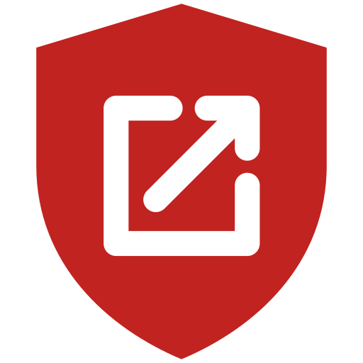

<p align="center">
  
</p>
<h1 align="center">TabBlock</h1>

<p align="center">
  Browser extension that stops unwanted tabs, pop-ups and advertising redirects<br />
  from opening when you click on streaming websites.
</p>

<div align="center">
  
  
  
  
  
  
</div>

<br />

<p align="center">
  <a href="#why">Why</a> •
  <a href="#installation">Installation</a> •
  <a href="#usage">Usage</a> •
  <a href="#how-it-works">How it works</a> •
  <a href="#features">Features</a> •
  <a href="#development">Development</a> •
  <a href="#publishing">Publishing</a> •
  <a href="#privacy">Privacy</a> •
  <a href="#support">Support</a>
</p>

<hr />
<br />

## Why

You click **Play** on a streaming site. A new tab opens on a casino. You close it, click again, and now the current page has been redirected to a "you won an iPhone" scam.

TabBlock puts an end to that. Turn it on for the sites you want to protect, keep clicking as usual, and every tab or redirect you **didn't actually ask for** is closed or undone instantly.

## Installation

> TabBlock is not on the stores yet. Install it manually in a few seconds:

```bash
git clone https://github.com/Lynch-cai/TabBlock.git
cd TabBlock
npm install
npm run build   # dist/chrome, dist/firefox
```

| Browser | Build | Install for development |
| --- | --- | --- |
| Chrome, Edge, Brave, Opera, Vivaldi, Arc | `extension/` or `dist/chrome/` | `chrome://extensions` (`edge://extensions`, …) → enable **Developer mode** → **Load unpacked** → pick the folder |
| Firefox 140+ | `dist/firefox/` | `about:debugging#/runtime/this-firefox` → **Load Temporary Add-on…** → `dist/firefox/manifest.json`, or `npm run start:firefox` |

Then pin TabBlock to your toolbar so the shield is always at hand.

> **Firefox**: Firefox lets you withhold site access from an extension. If TabBlock has no access to the current site, its popup shows an **Autoriser TabBlock sur ce site** (allow on this site) button: without access, TabBlock cannot see your clicks there and would treat every new tab as an ad.

## Usage

1. Go to the streaming website you want to protect, e.g. `stream.to`.
2. Click the TabBlock icon in the toolbar.
3. Turn the switch on: **Protection enabled on this site**.
4. Watch your movie. The badge on the icon counts every pop-up and redirect blocked on the current tab.

| Popup               | What it shows                                              |
| ------------------- | ---------------------------------------------------------- |
| **Site**            | The website of the current tab                             |
| **Blocked**         | Pop-ups and redirects blocked on this tab                  |
| **Total blocked**   | Everything blocked since you installed TabBlock            |
| **Switch**          | Turns protection on or off for this site                   |
| **Footer**          | How many sites you protect                                 |

> Protecting `stream.to` also protects all its subdomains (`www.stream.to`, `player.stream.to`, …).

## How it works

TabBlock doesn't rely on blocklists. It compares **what you clicked** with **what the page tries to open**.

```
  you click  ──►  content script records the link you really clicked
                               │
  page opens a tab / redirects ▼
                  service worker compares target vs. your click
                               │
          ┌────────────────────┴────────────────────┐
     same site or the link you clicked     anything else
          │                                         │
       ✅ allowed                    ❌ tab closed / navigation undone
```

- **New tabs & pop-ups**: allowed if they stay on the same site or match the link you just clicked. Otherwise the tab is closed.
- **Redirects of the current page**: same rule. An unwanted redirect is undone with a "back" navigation.
- **Link shorteners & `/out?url=` links**: a real click on a link that goes through a server redirect is always respected.
- **Back / forward**: never blocked.

Because the decision happens at the browser level, it also catches pop-ups fired from **cross-origin player iframes**, where most streaming ads live.

## Features

- [x] Per-site protection with one switch
- [x] Blocks pop-ups and new tabs opened by ads
- [x] Undoes advertising redirects of the current page
- [x] Works inside embedded video players (iframes)
- [x] Respects your real clicks, including link shorteners
- [x] Subdomains protected automatically
- [x] Per-tab badge and all-time counter
- [x] Zero dependencies, zero tracking, zero network requests
- [x] Chrome, Edge, Brave, Opera, Vivaldi, Arc and Firefox from one codebase
- [ ] Store releases
- [ ] English / French popup
- [ ] Prevent the ad tab from flashing briefly before being closed

## Development

Requirements: Node.js 24 (see `.nvmrc`).

```bash
npm install
npx playwright install chromium

npm run test:unit   # pure blocking logic (node --test)
npm run test:e2e    # real Chromium with the extension loaded (Playwright)
npm test            # both

npm run build          # dist/<browser>/ + store zips (or: node scripts/build.js firefox)
npm run lint:firefox   # web-ext lint on dist/firefox
npm run start:firefox  # Firefox with the extension, on the e2e fixture page (start node tests/e2e/server.js first)
```

`extension/` is the only source. `scripts/build.js` copies it once per browser family and only rewrites `manifest.json`:

- **chrome**: unchanged. The same zip goes to the Chrome Web Store, Edge Add-ons and Opera add-ons; Brave, Vivaldi and Arc install from the Chrome Web Store.
- **firefox**: `background.scripts` instead of `background.service_worker` (no MV3 service worker in Firefox), plus `browser_specific_settings.gecko` (add-on id, Firefox 140+, `data_collection_permissions: none`).

The code itself is identical for every browser.

Project structure:

```
.
├── extension/          # single source, loadable as-is in Chrome
│   ├── manifest.json   # Manifest V3 (Chrome base, patched per browser by the build)
│   ├── background.js   # service worker: closes pop-ups, undoes redirects
│   ├── content.js      # reports the link the user really clicked
│   ├── lib.js          # pure decision logic, shared with the tests
│   └── popup.*         # toolbar popup
├── scripts/build.js    # builds dist/chrome, dist/firefox + zips
├── dist/               # build output (git-ignored)
└── tests/
    ├── unit/           # lib.js tests
    └── e2e/            # fake streaming, ad and player pages + Playwright specs
```

After editing the code, click the ↻ button on the TabBlock card in <kbd>chrome://extensions</kbd>. For Firefox, run `npm run build` again (`web-ext run` reloads by itself).

## Publishing

| Store | Upload | Notes |
| --- | --- | --- |
| [Chrome Web Store](https://chrome.google.com/webstore/devconsole) | `dist/tabblock-chrome-<version>.zip` | One-time $5 developer fee |
| [Edge Add-ons](https://partner.microsoft.com/dashboard/microsoftedge/overview) | same zip | Free |
| [Opera add-ons](https://addons.opera.com/developer/) | same zip | Free |
| [Firefox Add-ons (AMO)](https://addons.mozilla.org/developers/) | `dist/tabblock-firefox-<version>.zip`, or `npx web-ext sign --source-dir dist/firefox --channel listed` with AMO API keys | Run `npm run lint:firefox` first. The add-on id `tabblock@lynch-cai.github.io` is frozen after the first upload |

Bump `version` in `extension/manifest.json` before each release: the build names the zips after it.

## Privacy

TabBlock runs **100% locally**. It never sends anything anywhere.

| Permission      | Why                                                        |
| --------------- | ---------------------------------------------------------- |
| `tabs`          | Read the URL of the current tab, close unwanted tabs       |
| `webNavigation` | Detect new tabs and redirects as they happen               |
| `storage`       | Remember your protected sites and the counters             |
| `<all_urls>`    | Detect your clicks on any site you choose to protect (content script + `host_permissions`, so Firefox can grant site access from the popup) |

The content script only listens to your clicks: it never reads, modifies or blocks anything on the page.

## Support

TabBlock is free and will stay that way. If it saves you from a few casino tabs, you can buy me a coffee:

<a href="https://ko-fi.com/lynch_"></a>
